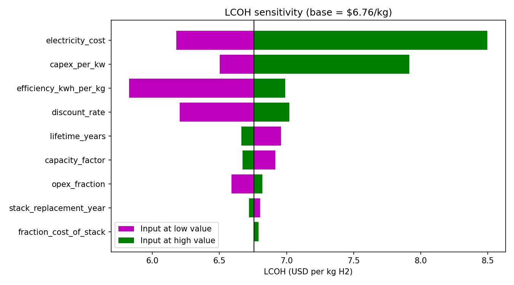
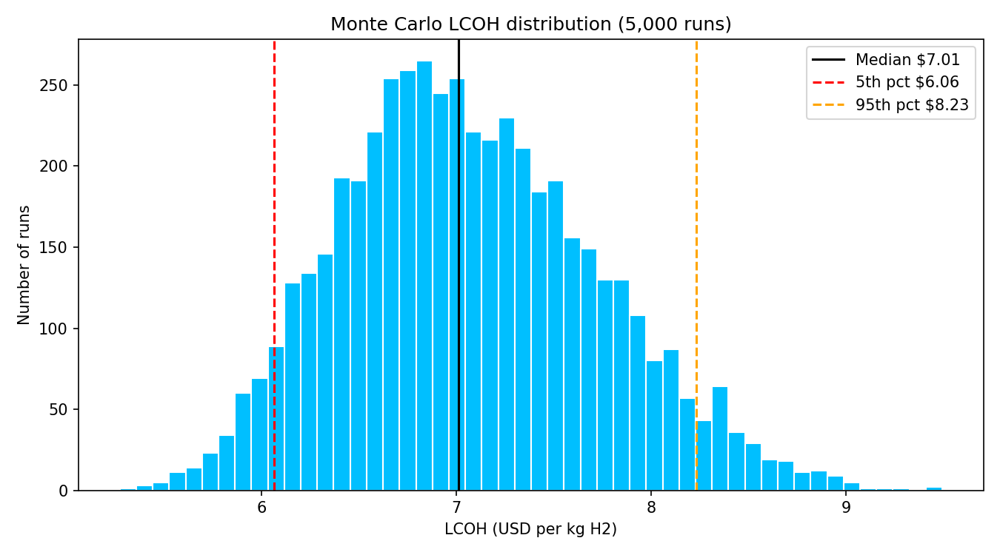
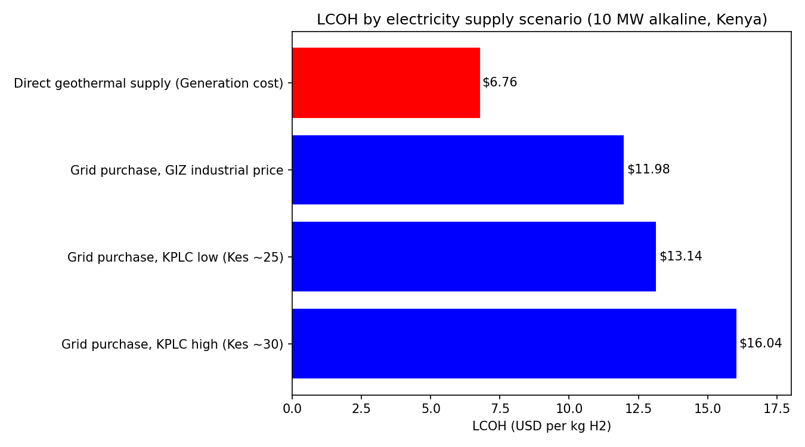

# LCOH Calculator: Geothermal-Powered Green Hydrogen in Kenya

A Python model calculating the **levelized cost of hydrogen (LCOH)** for a 10 MW alkaline electrolyzer powered by geothermal electricity in Kenya, with sensitivity and Monte Carlo analysis.

Author: Emeryne Odero

## Why this project

Electricity is the largest cost in green hydrogen production. Geothermal power runs at very high capacity factor compared to other renewables and is relatively cheap in Kenya,therefore making it a strong fit for hydrogen production. This project asks: **what does hydrogen cost under realistic Kenyan assumptions, which inputs matter most, and how much does the way the electrolyzer is supplied with power change the answer?**

## Key results

| Question | Result |
|---|---|
| Base case LCOH (direct geothermal supply at $0.07/kWh) | **$6.76 per kg** |
| Monte Carlo (5,000 runs): median, 90% range | **$7.01**, from **$6.06 to $8.23 per kg** |
| Most influential input | Electricity price, followed by electrolyzer CAPEX and efficiency |
| Grid purchase at retail tariffs ($0.16 to $0.23/kWh) | **$11.98 to $16.04 per kg** |

### Sensitivity Analysis: which inputs matter most



Electricity price swings the LCOH by about $2.3/kg across its range, CAPEX by about $1.4/kg, and efficiency by about $1.2/kg. Discount rate follows at about $0.8/kg.

### Uncertainty: Monte Carlo distribution



All inputs were varied at once using triangular distributions (low, most likely, high) built from the ranges below.

### Supply arrangement: Direct geothermal vs grid



The lcoh roughly doubles when run on grid power at retail tariffs compared to when run on power supplied directly at generation cost.

## Method

The model discounts all costs and all hydrogen output over the project life:

```
LCOH = (CAPEX + sum of discounted yearly costs) / (sum of discounted yearly hydrogen)
```

It includes CAPEX, electricity, fixed O&M, and one stack replacement. The code was cross-checked against the closed-form annuity formula. See `lcoh.py` for the function and `01_lcoh_basic.ipynb` for the analysis.

## Inputs and sources

| Input | Base | Range | Source |
|---|---|---|---|
| Electricity cost | $0.07/kWh | 0.06 to 0.10 | [ThinkGeoEnergy](https://www.thinkgeoenergy.com/kenya-seeks-tax-breaks-to-keep-geothermal-power-prices-low/): tariff cap below KES 9/kWh. Generation-level price. |
| Electrolyzer CAPEX | $2,100/kW | 1,900 to 3,000 | [EH2 whitepaper, 2024](https://eh2.com/wp-content/uploads/2025/01/Final_PEM_vs_Alkaline_December_2024_Whitepaper.pdf) |
| Efficiency | 58 kWh/kg | 50 to 60 | EH2 whitepaper (plant-level, including compression) |
| Fixed O&M | 2.6% of CAPEX per year | 1.5% to 3% | EH2 whitepaper |
| Stack replacement | 15% of CAPEX, year 10 | 15% to 20% | EH2 whitepaper |
| Discount rate | 13% | 8.5% to 15% | [GIZ Kenya study, 2025](https://www.giz.de/sites/default/files/media/pkb-document/2025-10/giz2025-en-ke-pdp-sectoranalysis-green-ammonia-fertiliser-applications.pdf); [IEA](https://www.iea.org/commentaries/how-a-high-cost-of-capital-is-holding-back-energy-development-in-kenya-and-senegal) |
| Capacity factor | 90% | 85% to 93% | **Assumption** |
| Project lifetime | 20 years | 15 to 25 | **Assumption** |

Grid-purchase scenarios use $0.16/kWh (industrial price in the GIZ study) and $0.18 to $0.23/kWh (KPLC retail range, KSh 25 to 30).

## Limitations

- The base case assumes power at generation cost with no transmission or wheeling charges, only realistic if the electrolyzer is next to the geothermal plant.
- Capacity factor and the project lifetime are assumptions.
- Cost figures rely mainly on one industry whitepaper, so CAPEX may not match local quotes.
- Monte Carlo inputs are sampled independently, although in reality some move together (for example CAPEX and discount rate).
- Not modeled: water cost, compression and storage beyond the efficiency figure, stack degradation, and electrolyzer partial-load operation.

## How to run

```
git clone https://github.com/Emeryne/lcoh-calculator.git
cd lcoh-calculator
pip install -r requirements.txt
jupyter notebook 01_lcoh_basic.ipynb
```

Or use the model directly:

```python
from lcoh import calculate_lcoh

calculate_lcoh()   # base case
calculate_lcoh(electricity_cost=0.18) # grid purchase
```

## Next steps

- Electrolyzer sizing tool driven by a geothermal plant output profile, reusing this model as the objective.
- Add water, compression and storage costs.
- Source capacity factor and lifetime for Kenyan geothermal plants.